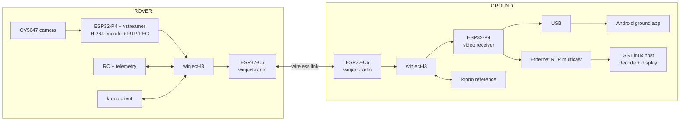

# Flying Computer II

Building blocks for **UAS (Unmanned Autonomous Systems)**: radio communication, video systems, and autonomous control systems.

## Main components

- **ROV — remotely operated vehicle:** rover, fixed-wing aircraft, helicopter, or multicopter.
- **GND — ground station:** the radio, video, and control equipment used to operate and monitor the vehicle.

## Supported platforms

## System at a glance

The rover and ground P4 boards run matching winject-l3 radio configurations. The ESP32-C6 runs winject-radio and connects to the P4 over SDIO. On the rover, the P4 captures OV5647 video and the vstreamer pipeline performs H.264 encoding, RTP packetization, and application-level FEC. On the ground P4, the receiver recovers the stream and sends it to Android over USB and to the local network over RTP multicast.

## Repositories

### Rover

- [rov-esp32p4](https://github.com/FlyingComputer2/rov-esp32p4) — Rover P4 application: radio proxy, winject-l3, live camera/video transmit, clock-sync client, and RC rover sample.
- [vstreamer](https://github.com/FlyingComputer2/vstreamer) — Composable camera, codec, RTP, and streaming components used by the video pipeline.
- [HAL](https://github.com/FlyingComputer2/HAL) — Hardware abstraction interface declarations.

### Ground station

- [gnd-esp32p4](https://github.com/FlyingComputer2/gnd-esp32p4) — Ground P4 firmware: radio proxy, winject-l3, video receiver, USB transport, and Ethernet multicast.
- [gnd-android](https://github.com/FlyingComputer2/gnd-android) — Android USB ground app for viewing rover video and carrying ground-side channels.
- [gnd-vstreamer-mcsink](https://github.com/FlyingComputer2/gnd-vstreamer-mcsink) — Linux receiver and display path for RTP H.264 multicast, with decode metrics and OSD.
- [gnd](https://github.com/FlyingComputer2/gnd) — Earlier Orange Pi 5 ground station using RTL8812AU; archived as the stack moved to the P4 ground board.

### Shared components

- [krono](https://github.com/FlyingComputer2/krono) — Clock sources and synchronization for rover, ground boards, and host.
- [winject-l3](https://github.com/winject-wireless/winject-l3) — Layer 3 radio manager.
- [winject-radio-esp32-sdio-proxy](https://github.com/winject-wireless/winject-radio-esp32-sdio-proxy) and [winject-radio-esp32c6](https://github.com/winject-wireless/winject-radio-esp32c6) — ESP32-P4/C6 radio interface and C6 radio firmware.

## Video, control, and time

- **Video:** OV5647 camera → vstreamer H.264 encode, RTP packetization, and application-level Reed–Solomon FEC → radio link → ground receive and fanout.
- **Control and telemetry:** RC and rover telemetry travel on a separate radio upstream; the ground P4 bridges frames to Android USB and bench tools.
- **Clock sync:** The ground P4 provides the reference clock. The rover synchronizes over the radio, while the Android app synchronizes over USB; the ground host follows the ground P4.
- **Ground viewing:** Android receives video over USB. The P4 also multicasts recovered RTP H.264 to the ground network for a Linux decode/display path.

The repositories contain build instructions, interface details, wiring notes, and bench procedures. Start with [rov-esp32p4](https://github.com/FlyingComputer2/rov-esp32p4) for the rover or [gnd-esp32p4](https://github.com/FlyingComputer2/gnd-esp32p4) for the ground board.
